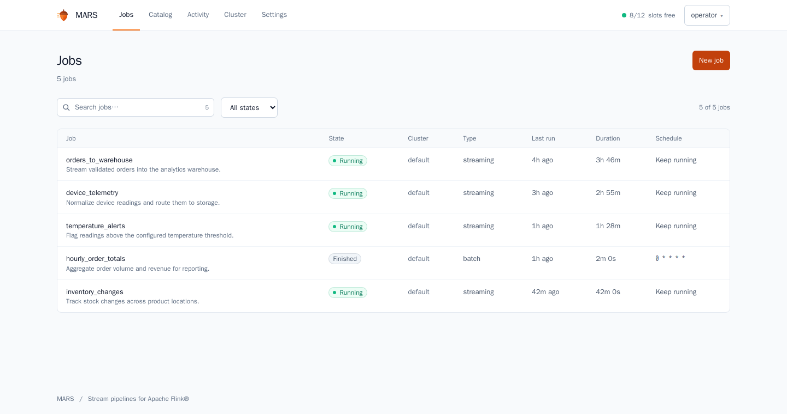

# MARS

**A web console for Apache Flink SQL.**

Build streaming pipelines, manage reusable tables, and operate jobs across Flink
clusters from one workspace. MARS brings SQL editing, a pipeline map, scheduling,
savepoints, and run history alongside your cluster, so you can follow a pipeline
from its definition to its running jobs.



*The Jobs workspace in dark mode. All pipelines and operational data shown are synthetic.*

## Why MARS?

Writing a streaming query is only part of running a pipeline. As pipelines grow,
table definitions, submission scripts, schedules, and recovery steps can become
scattered across files and services. Answering everyday questions takes more work:
Which job writes this topic? Is it making progress? Where is its saved state, and
how do I resume it after maintenance?

MARS brings that work into one place for people running their own Flink clusters.
It connects reusable SQL definitions to the jobs executing them, shows how data
flows between systems, and provides controls for scheduling, monitoring, and
recovery. The goal is to reduce custom operational scripts and manual bookkeeping
as a collection of pipelines grows, while keeping Flink responsible for execution.

## What you can do

| Area | Capabilities |
| --- | --- |
| **Build pipelines** | Write SQL with connector forms, validation, source samples, and output previews. Optional AI assistance helps draft SQL. |
| **Understand data flow** | Reuse catalog tables, see which jobs read and write each topic or database, and explore an interactive pipeline map. |
| **Operate jobs** | Run streaming and scheduled batch jobs, configure restart supervision, inspect diagnostics, and stop or resume with saved state. |
| **Manage clusters** | Register local or remote Flink clusters, inspect CPU, memory and slots, and move jobs using verified shared savepoint storage. |
| **Organize work** | Tag and filter jobs, apply bulk move/stop/resume actions, review definition versions, and import or export YAML. |
| **Administer access** | Manage administrator, editor and viewer roles, API tokens, and encrypted connection secrets. |

Guided rolling upgrades, savepoint retention, Prometheus metrics, optional update
checks, and opt-in backup restore drills support ongoing operation. See the
[roadmap](ROADMAP.md) for current capabilities and the reliability work still open.

## Quick start

Requires **Git**, **Docker with Compose v2**, and roughly **6 GB of available RAM**
for the default stack. The first build downloads images and dependencies.

```bash
git clone https://github.com/DevinMB/mars.git
cd mars
cp .env.example .env
docker compose up -d --build
```

Wait for the services to become healthy; check startup with `docker compose ps`.
Open **[localhost:8080](http://localhost:8080)**. Retrieve the generated
administrator password locally, sign in as `admin`, and change it when prompted:

```bash
docker compose logs console | grep -A4 'administrator'
```

The log contains a credential; keep it private. If the initial log is no longer
available, use the [local password reset](docs/deployment.md#accounts-and-automation).

### Run your first pipeline

A fresh installation seeds `example_temperature_alerts`, which labels generated
sensor readings and writes the results to the TaskManager log. It needs no Kafka
broker, database, or AI provider.

1. Open **Jobs → example_temperature_alerts** and choose **Run**.
2. Confirm that the job is running, then view its output:

   ```bash
   docker compose logs -f taskmanager
   ```

3. Choose **Stop and save state** when finished. **Resume** starts it again from
   saved state. You can edit the SQL and use **Preview output** before running
   your own variation.

The example definitions are in [`examples/getting-started.yaml`](examples/getting-started.yaml).
They are seeded once and can be deleted; set `MARS_SEED_EXAMPLES=false` before the
first startup to skip them.

### What the stack includes

The default stack builds **Flink 2.2.1**, a SQL Gateway, and the MARS console
(FastAPI, React, and SQLite). Kafka, datagen, and print connectors are available
in a clean local build. Additional connectors and Avro formats can be added using
the [connector guide](docs/connectors.md). The
[released Flink images](docs/deployment.md#released-images) also bundle the pinned
MARS connector set and optional formats.

The console and Flink UI bind to localhost by default; the SQL Gateway stays
inside the Compose network. For remote access, use an SSH tunnel or follow the
[deployment guide](docs/deployment.md#network-access).

## How it works

MARS manages definitions and job lifecycles; Flink executes the pipelines. Streaming
records flow between Flink and your sources and sinks. When you request a preview,
MARS queries Flink and returns sample rows to the browser.

```text
browser ──► MARS console ──SQL──► Flink SQL Gateway ──► JobManager / TaskManagers
           (FastAPI, React,                                  │
            SQLite)  ◄──── status, checkpoints, savepoints ──┘
```

When you run a job, MARS:

1. Collects its referenced catalog definitions in dependency order.
2. Combines those definitions with the job's SQL and resolves `${secret:name}`
   references for submission.
3. Opens a SQL Gateway session on the selected cluster, replays the definitions,
   and submits the job.
4. Records the Flink job ID and tracks its run, diagnostics, and restore points.

Definitions are replayed on each submission, so no external metastore is required.
Multiple inserts can run together in an `EXECUTE STATEMENT SET`. For Kafka tables
without an explicit consumer group, MARS assigns a group per job; see
[consumer groups](docs/connectors.md#kafka-consumer-groups).

## Deployment and recovery

MARS is intended for **trusted operators on a protected network**. Keep Flink REST
and SQL Gateway endpoints private; they do not inherit MARS authentication. Use
HTTPS for shared access and store connection credentials in **Settings → Secrets**.
See [Security](SECURITY.md) for access boundaries and AI-provider data handling.

The default Compose stack is a **single-host deployment without Flink high
availability**. Resume and restart supervision use recorded savepoints or
checkpoints, subject to state availability and connector semantics. Back up both
MARS's database and encryption key, and Flink's state; a YAML definition export is
not a full backup.

Stateful moves and rolling upgrades require shared savepoint storage and capacity
on the destination. Slow-savepoint timeouts and overlapping state operations have
[known reliability gaps](ROADMAP.md#next-operational-reliability). Review
[recovery and failover](docs/deployment.md#recovery-and-failover) and
[moving jobs between clusters](docs/deployment.md#job-moves-between-clusters)
before planning maintenance.

## Documentation

| Guide | Contents |
| --- | --- |
| [Deployment and recovery](docs/deployment.md) | Configuration, network access, accounts, backups, upgrades, job moves, and monitoring. |
| [Connectors and formats](docs/connectors.md) | Connector installation, credentials, catalog grouping, and Kafka consumer groups. |
| [Remote clusters](remote-target/README.md) | Run a separate Flink cluster and register it with MARS. |
| [Development](docs/development.md) | Local setup, builds, tests, and reproducible screenshots. |
| [Security](SECURITY.md) | Trust boundaries, credential handling, and vulnerability reporting. |
| [Roadmap](ROADMAP.md) | Shipped features, ordered priorities, and planned work. |

MARS is under active development and is available under the [MIT License](LICENSE).

---

MARS is an independent project, not affiliated with the Apache Software Foundation.
Apache Flink® is a registered trademark of the ASF.
